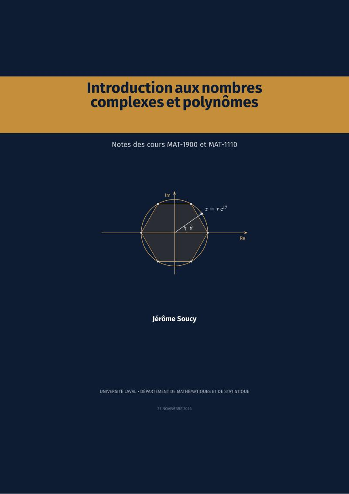

# Au sujet de ces notes {.unnumbered .avant-propos}

<!-- Couverture : version web seulement. Un clic télécharge le PDF, produit
     dans _book/ par « quarto render » (les deux formats à la fois). -->
::: {.content-visible when-format="html"}
```{=html}
<figure class="couverture">
  <a href="Introduction-nombres-complexes.pdf" download
     title="Télécharger les notes en PDF">
    
  </a>
  <figcaption>Cliquez sur la couverture pour télécharger les notes en PDF.</figcaption>
</figure>
```
:::

::: {.credits}
Ces notes présentent les notions de base concernant les nombres
complexes. Elles sont destinées aux étudiantes et étudiants des cours
*MAT-1900 : Mathématiques de l'ingénieur 1* et *MAT-1110 : Calcul des
fonctions de plusieurs variables* de l'Université Laval. Le chapitre 1
rappelle différents contextes où l'introduction de nouveaux types de
nombres s'est avérée nécessaire, ainsi que certaines propriétés des
opérations élémentaires que sont l'addition et la multiplication. Les
chapitres 2 à 4 traitent de la forme cartésienne des nombres complexes
(opérations, module, conjugué, lieux géométriques) ; les chapitres 6 à 9,
de leurs formes polaire et exponentielle, des formules d'Euler et de
De Moivre et des racines $n$-ièmes. Les chapitres 5 et 10 rassemblent
des exercices ; leurs solutions sont regroupées à la fin du document.

\medskip

**Avis d'utilisation de l'IA.** Des outils d'IA (principalement Claude
Opus 5.5) ont été utilisés pour convertir ce document au format Quarto,
pour adapter les figures TikZ et pour corriger certaines coquilles. Le
contenu a ensuite été vérifié et validé par l'auteur.

\medskip

Pour signaler une erreur dans ce document, veuillez écrire à
[jerome.soucy@mat.ulaval.ca](mailto:jerome.soucy@mat.ulaval.ca).

\vfill

```{=html}
<div class="licence">
  <a class="licence-icones" href="https://creativecommons.org/licenses/by-nc-sa/4.0/deed.fr"
     rel="license" title="Licence Creative Commons Attribution – Pas d'utilisation commerciale – Partage dans les mêmes conditions 4.0 International">
    
    
    
    
  </a>
  <div>
    <div class="licence-titre">Ressource éducative libre</div>
    <div class="licence-nom">Licence CC BY-NC-SA 4.0</div>
  </div>
</div>
```

```{=latex}
\noindent{\fontsize{22}{22}\selectfont\ccbyncsa}\quad
\raisebox{0.45em}{\textbf{Ressource éducative libre — Licence CC BY-NC-SA 4.0}}
\par\medskip
```

© 2026 Jérôme Soucy. Ce document est une ressource éducative libre, mise
à disposition selon les termes de la licence [Creative Commons Attribution
– Pas d'utilisation commerciale – Partage dans les mêmes conditions 4.0
International](https://creativecommons.org/licenses/by-nc-sa/4.0/deed.fr)
(CC BY-NC-SA 4.0). Vous pouvez le copier, le redistribuer, l'adapter, le
traduire et le réutiliser en tout ou en partie, à condition de citer
l'auteur original, d'indiquer si des modifications ont été faites, de ne
pas en faire un usage commercial et de diffuser toute version modifiée
sous la même licence. Les sources sont disponibles sur
[GitHub](https://github.com/soucyj/NbComplexes).

Pour citer ce document : Jérôme Soucy, *Introduction aux nombres
complexes et polynômes*, notes des cours MAT-1900 et MAT-1110, Université
Laval, 2026.
:::
